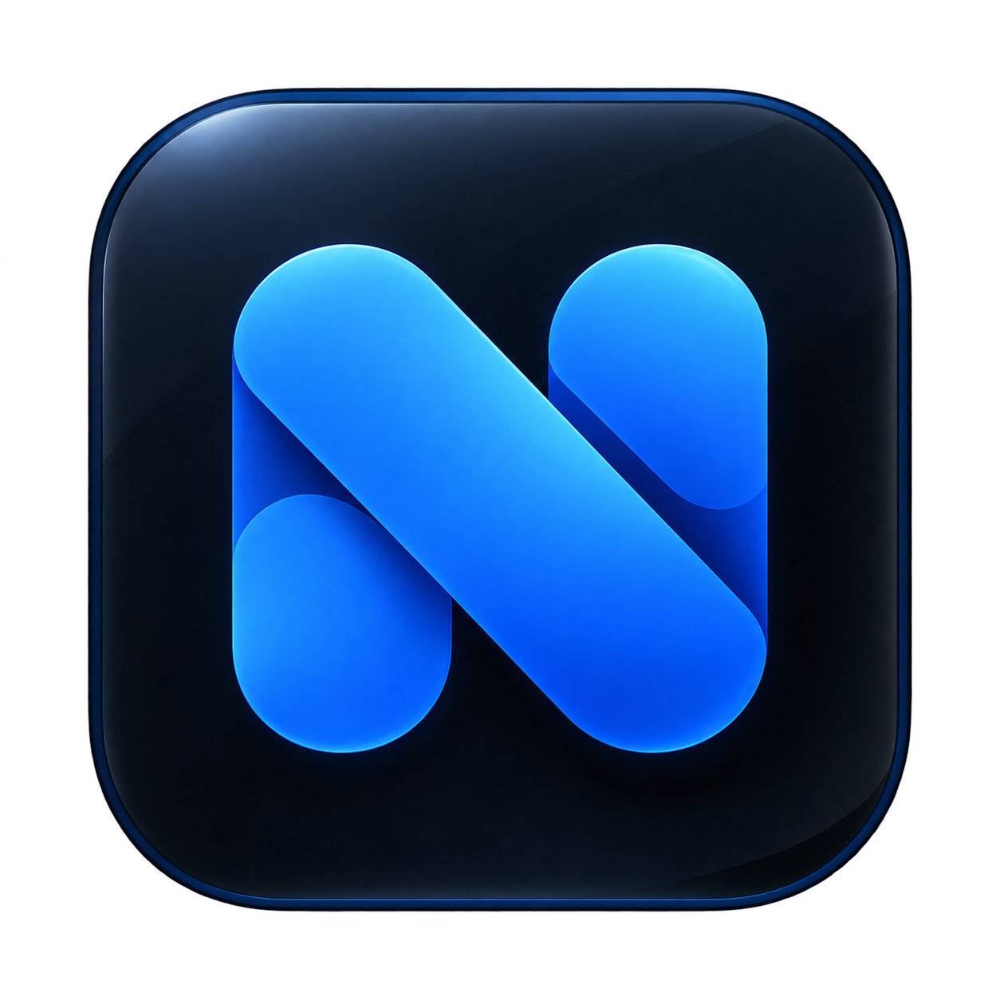

# Nimqulo



An Android messenger for trusted connections, private conversations, and small groups.

**[Download Nimqulo-v1.apk](https://nimqulo-downloads.nimqulo-realtime.workers.dev/Nimqulo-v1.apk)**

Signed release APK · 36.6 MB · Android 7.0+ · ARM32/ARM64

Administrator approval is required after Google sign-in. The release backend is deployed; two-phone acceptance testing remains outstanding.

## Features

- Google sign-in with administrator-approved access.
- Profiles, unique usernames, username autocomplete, and connection requests.
- Direct messages and invitation-based groups with owner/admin roles.
- Realtime text and photo messages, date separators, swipe to reply, read receipts, and animated typing indicators.
- Unread counts, request/invitation badges, Android push notifications, and configurable notification previews.
- Cached conversations and drafts, clear send failures, and manual retry after reconnecting.
- Blocking, reporting, moderation, account suspension, and account deletion.

## Install on Android

1. Download the release APK using the link above.
2. Allow your browser or file manager to install this app when Android asks.
3. Install Nimqulo and sign in with Google.
4. Wait for administrator approval, then confirm your display name and username to open Chats.

The release APK runs independently of a development computer, Metro, Expo Go, or Google Play. Updates must use an APK signed with the same signing key. The initial rollout allows up to 20 approved accounts; downloading the APK does not grant access automatically.

<details>
<summary>Verify the APK</summary>

SHA-256:

```text
7e43da4ff39f4facf789af523ceb46ec38df68a2ad506113dbba1cc32f89516f
```

Package: `com.jeeva.nimqulo` · Version code: `4` · Exact size: `36,564,298` bytes.

</details>

## Privacy and safety

Access is checked by the backend for every protected operation. Notification message previews default to off. Blocking prevents new direct contact; existing shared-group messages remain visible.

Nimqulo is **not end-to-end encrypted**. Account deletion cannot recall screenshots, previously displayed notifications, or offline copies held by other users.

## Development

Built with Expo SDK 58, React Native, TypeScript, Expo Router native tabs, Firebase Authentication, Neon Postgres/Functions/Object Storage, and a Cloudflare WebSocket coordinator. Android is the supported platform.

```sh
npm ci
# Configure local development values using .env.example.
npm start
```

Native features require an Android development build. Use a separate database and service credentials for development; never put server secrets in `EXPO_PUBLIC_*` variables or commit environment files.

```sh
npm run lint
npm run typecheck
npm test
npm run test:realtime
npm run build
```

Database integration tests require an explicitly isolated Neon endpoint; see [backend implementation and validation](docs/messenger.md). See [release preparation](docs/release.md) for build configuration, the release checklist, and validation details.

## Project structure

- `src/` — Android screens, navigation, components, and client state.
- `assets/` — app icons, fonts, and artwork used by the app.
- `backend/` — authenticated API and database migrations.
- `realtime/` — Cloudflare messaging coordinator and its tests.
- `downloads/` — public APK download with the release filename.
- `plugins/` — native Android configuration plugins.
- `scripts/` and `tests/` — build, maintenance, and validation tools.
- `docs/` — authentication, development, backend, and release guides.

Local credentials, generated builds, dependencies, and editor/agent files are excluded from Git. Keep `google-services.json` locally and configure its EAS file variable for cloud builds; never commit Firebase Admin keys.

## Support

For access requests and support, email [jeevanofficial1120@gmail.com](mailto:jeevanofficial1120@gmail.com).

## License

[MIT](LICENSE).
